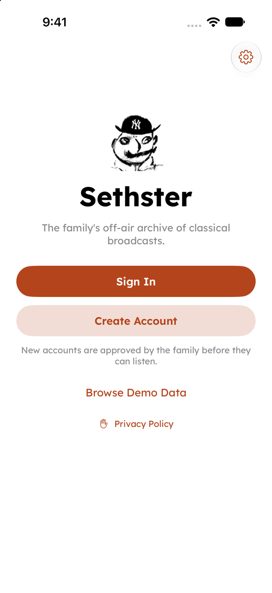
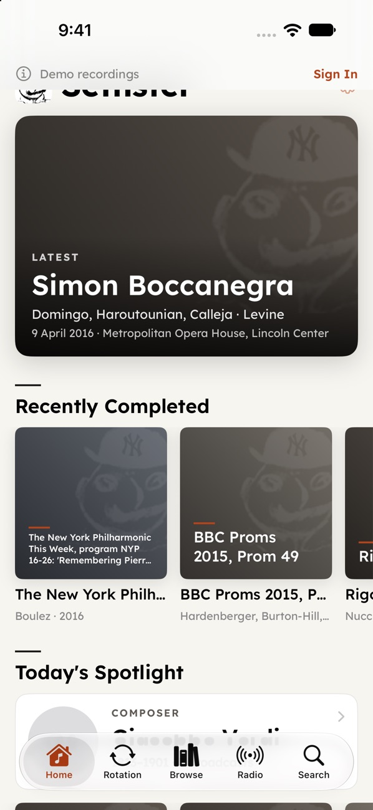
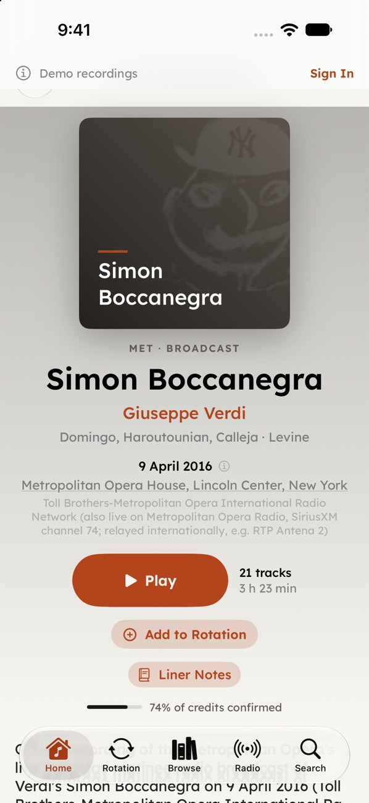
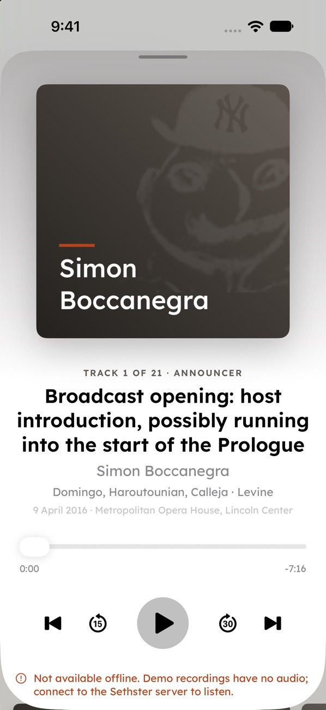
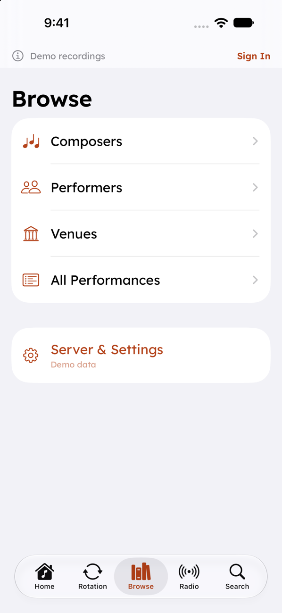
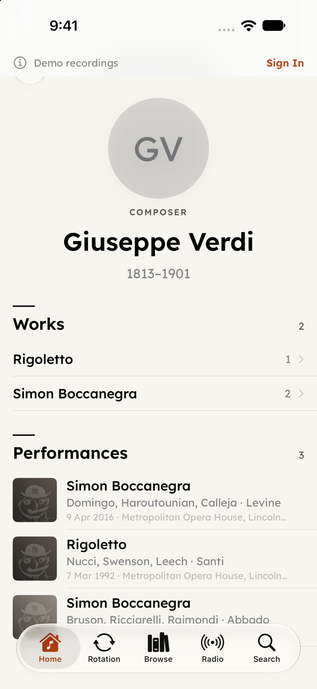
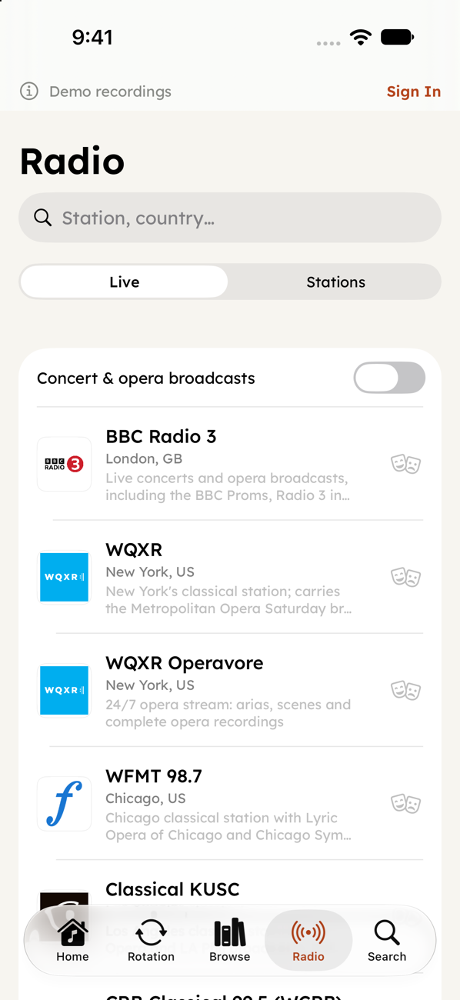
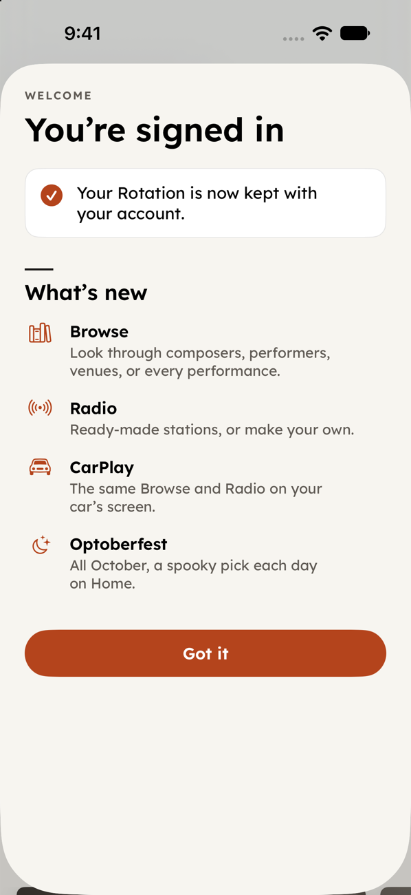

# Sethster

Sethster is a private, Roon-style classical music archive that I built for my dad, who has spent decades recording classical broadcasts off the air: Met Opera Saturdays, BBC Proms, the New York
Philharmonic, Bayreuth, and many more. The recordings live on a Synology NAS in folders named like
`YYMMDD Title`. Sethster turns them into a browsable library. Each performance shows what was played, who
performed **on that date** (not just the production's announced cast), where it took place, and a source for
every credit. There are three parts: an iPhone app with CarPlay, a small FastAPI server that runs on the NAS,
and a research pipeline that identifies the recordings.

<table>
  <tr>
    <td></td>
    <td></td>
    <td></td>
    <td></td>
  </tr>
  <tr>
    <td align="center">Sign in</td>
    <td align="center">Home</td>
    <td align="center">Performance</td>
    <td align="center">Now Playing</td>
  </tr>
  <tr>
    <td></td>
    <td></td>
    <td></td>
    <td></td>
  </tr>
  <tr>
    <td align="center">Browse</td>
    <td align="center">Composer</td>
    <td align="center">Radio</td>
    <td align="center">Welcome card</td>
  </tr>
</table>

<sub>Screenshots are from the iOS simulator in demo mode, which uses bundled sample data with no audio.</sub>

## Features

**iPhone app (SwiftUI, iOS 18+)**

- **Home**: the latest performance, Recently Completed, Today's Spotlight and On This Day.
- **Rotation**: a short personal list of performances. Their original tracks are downloaded and kept ready
  for offline play.
- **Browse**: composers, performers, venues and every performance.
- **Radio**: seeded stations built from the archive (composer, performer or ensemble), plus a directory of
  live classical stations with a "concert & opera broadcasts" filter.
- **Search** across the whole archive.
- **Detail pages** for composers, works, performers, venues and performances. Performance pages have track
  lists with segment labels (music, announcer, intermission, applause), liner notes with citations,
  announcer transcripts, historical context, other versions of the same work, and a "credits confirmed"
  meter.
- **Optoberfest**: in October, Home shows a daily spooky pick ("Happy Halloween" on the 31st).
- **Welcome card** that explains what's new after sign-in.
- **Settings** (the gear button) for the server address, the account, and admin approvals.
- **CarPlay audio** with Rotation, Performers, Browse and Radio tabs. It shares the phone's player.
  See [`ios/CARPLAY.md`](ios/CARPLAY.md).
- **Demo mode**: "Browse Demo Data" on the welcome screen works without a server.

**Accounts**

- People sign up with a username and password, and an admin approves them in the app.
- Admins get a push notification for each new sign-up. Users get one when they're approved.
- Each approved user has their own Rotation.
- See [`docs/plans/accounts.md`](docs/plans/accounts.md) and [`docs/api-accounts.md`](docs/api-accounts.md).

**Server**

- FastAPI + SQLite. Reads the media share **read-only** and streams with HTTP Range support.
- Transcodes lossless files (FLAC/WAV) to AAC with ffmpeg and caches the results.
- Lazily caches composer and performer images from Wikimedia Commons.

## Architecture

```
 ┌──────────────┐   HTTPS / LAN    ┌────────────────────────── Synology NAS ───────────────────────────┐
 │ iPhone app   │ ───────────────▶ │  docker compose: sethster (FastAPI, :8642)                         │
 │  + CarPlay   │ ◀─────────────── │    ├─ /data   sethster.db, accounts, rotation, cache  (read-write) │
 └──────────────┘   JSON + audio   │    └─ /media  recordings share                         (read-only) │
                                   └─────────────────────────────▲──────────────────────────────────────┘
                                                                 │ importer builds sethster.db
                                       ┌─────────────────────────┴───────────────────────────┐
                                       │ pipeline/ (on a Mac): research results, dossiers,   │
                                       │ wiki enrichment, transcripts, segmentation, context │
                                       └─────────────────────────────────────────────────────┘
```

| Path | What it is |
|---|---|
| `ios/` | SwiftUI app and CarPlay scene. The Xcode project is generated from `ios/project.yml` with [XcodeGen](https://github.com/yonaskolb/XcodeGen). |
| `server/` | `sethster_server` package: API (`app.py`), importer, accounts, Rotation, Radio, media and transcoding. Tests are in `server/tests/`. |
| `pipeline/` | Research and enrichment jobs that produce the data the importer reads. |
| `docs/` | API notes, design plans (`docs/plans/`) and screenshots. |

## Install and run

### Server (Docker Compose on a NAS)

You need Docker with Compose (Synology Container Manager works), a folder of recordings, and a data folder
with the research output (`pilot/results`, `research/results`, dossiers, and optionally `wiki/`).

1. Copy `server/` and your `data/` folder to the NAS, for example `/volume1/docker/sethster/{server,data}`.
2. `server/docker-compose.yml` mounts these volumes (paths relative to `server/`):

   ```yaml
   volumes:
     - ../data:/data                                  # research data in; sethster.db and cache/ out
     - "${SETHSTER_MEDIA_DIR}:/media:ro"              # the recordings share, mounted READ-ONLY
     - ../secrets:/secrets:ro                         # optional: apns.p8 for push; absent = push off
   ```

3. Copy `server/.env.example` to `server/.env` and fill it in. `SETHSTER_MEDIA_DIR` is required:

   ```bash
   # Host path of the recordings share (mounted read-only):
   SETHSTER_MEDIA_DIR=/volume1/your-music-share
   # off | dormant | on (see below)
   SETHSTER_ACCOUNTS=on
   TZ=America/New_York
   # Optional, for push notifications:
   APNS_KEY_ID=
   ```

4. Build and start the server:

   ```bash
   cd /volume1/docker/sethster/server
   docker compose up -d --build
   curl http://your-nas.local:8642/api/health
   ```

   On first start, the server builds `/data/sethster.db` if it is missing. Most Synology Plus models are x86-64. If you
   build the image on an Apple-silicon Mac, add `--platform linux/amd64`.

5. Create the first admin account (you'll be asked for the password):

   ```bash
   docker compose exec sethster python -m sethster_server.accounts create-admin your-username --display-name "Your Name"
   ```

   Other commands: `create-user`, `list`, `reset-password`, `delete`, and `move-rotation`. After this, you
   approve new sign-ups from **Settings → Approvals** in the app.

6. Re-import after new research (the database is swapped in atomically, so no restart is needed):

   ```bash
   docker compose exec sethster python -m sethster_server.importer
   docker compose exec sethster python -m sethster_server.warm   # optional: pre-transcode lossless tracks
   ```

**Environment variables**

| Variable | Default | Meaning |
|---|---|---|
| `SETHSTER_ACCOUNTS` | `off` | `off`: legacy token auth. `dormant`: account routes are live but content is open. `on`: every content route needs an approved account. |
| `SETHSTER_TOKENS` | *(empty)* | Legacy comma-separated bearer tokens, used only when accounts are `off`. If empty, auth is off. |
| `SETHSTER_DATA` | `/data` | Data dir: results, dossiers, wiki, DB, cache |
| `SETHSTER_MEDIA_DIR` | *(required)* | Compose only: host path of the recordings share, mounted read-only at `/media`. |
| `MEDIA_ROOT` | `/media` | Root of the recordings share. Track paths are relative to it. |
| `SETHSTER_DB` / `SETHSTER_CACHE` | `$SETHSTER_DATA/sethster.db` / `…/cache` | SQLite file and transcode/image cache |
| `SETHSTER_HOST` / `SETHSTER_PORT` | `0.0.0.0` / `8642` | Listen address |
| `SETHSTER_AAC_ENCODER` / `SETHSTER_AAC_BITRATE` | `aac` / `256k` | Transcode settings |
| `APNS_KEY_ID` | *(empty)* | APNs key id. The key itself goes in `/secrets/apns.p8`. |
| `SETHSTER_CONTACT_EMAIL` | *(empty)* | Contact address shown on `/privacy` (replaces the placeholder). |
| `TZ` | `America/New_York` | Server time zone ("On This Day", calendar) |

To reach the server from outside your home network, put it behind HTTPS (for example, the Synology reverse
proxy or Tailscale) and keep `SETHSTER_ACCOUNTS=on`. The interactive API docs are at
`http://your-nas.local:8642/docs`.

**Local development** (Python 3.12+, ffmpeg on `PATH`):

```bash
cd server
pip install -e .            # or: uv sync
MEDIA_ROOT=/path/to/music SETHSTER_DATA=/path/to/data python -m sethster_server.importer
MEDIA_ROOT=/path/to/music SETHSTER_DATA=/path/to/data python -m sethster_server
pytest tests -q
```

### iOS app

Requirements: Xcode 16+ (the app targets iOS 18 and uses Swift 6), and XcodeGen (`brew install xcodegen`).

```bash
cd ios
xcodegen generate
open Sethster.xcodeproj
```

1. In `ios/project.yml`, set `DEVELOPMENT_TEAM` to your own team ID and change `bundleIdPrefix` and
   `PRODUCT_BUNDLE_IDENTIFIER` to your own. Then run `xcodegen generate` again. You can also change
   them under Signing & Capabilities in Xcode.
2. Point the app at your server. Copy `ios/Config/Local.example.xcconfig` to `ios/Config/Local.xcconfig`
   (gitignored) and set `SETHSTER_DEFAULT_SERVER` and, optionally, the fallback and alias lists. They reach
   the app through Info.plist. Without that file the app builds with a placeholder server, and you can enter
   the address (for example `http://your-nas.local:8642`) under the gear button → Server URL.
3. Build and run on a simulator or a device. To try the app without a server, tap **Browse Demo Data**.
4. CarPlay needs Apple's `carplay-audio` entitlement on your App ID. Without it, remove
   `CODE_SIGN_ENTITLEMENTS` from `project.yml` to build for a device. For screenshots, the launch
   argument `-demoBrowse YES` opens the demo data directly.

The app is distributed privately to friends and family through TestFlight. There is no public build.

## Research pipeline

Most recordings are off-air broadcasts with no CD database entry. The metadata has to be reconstructed from
folder names, archives and the broadcasts themselves. The core rule: **credit who performed that date**.
Each credit has a source and a status (`confirmed`, `production_only`, `inferred` or `conflict`).

- **Identification research**: LLM-assisted web research matches each broadcast to performance archives,
  programs, reviews and Wayback Machine snapshots. Independent audit passes then check the work, date,
  venue and cast. A separate queueing daemon (`researchd`, kept outside this repo) runs these jobs.
  `pipeline/urgent.py` and `pipeline/deaths.py` move recent obituaries and seasonal themes to the front
  of the queue.
- **Announcer transcripts** (`announcers.py`, `run_announcers.py`): Whisper transcribes the intro, outro and
  intermission segments, which often name the cast and date.
- **Wiki enrichment** (`enrich_wiki.py`): verifies Wikidata QIDs and caches Wikipedia and Commons data
  for composers, works, performers and venues.
- **Segmentation** (`segment/`): finds silence and applause to split long recordings into pieces.
- **Historical context** (`context/`): short, cited paragraphs built from Wikidata and Wikipedia facts,
  plus an In Memoriam feed.
- **Crutchfield CD collection** (`crutchfield/`): a read-only metadata harvest of the opera CD library.
- **Readiness** (`readiness.py`): reports which broadcasts are fully done (notes, transcript, split, photos).
- **Safety**: nothing writes to the original share. Tagging experiments (`tag_sandbox.py`) go through
  `tagsafe.py`, which only permits writes inside a sandbox clone.

Jobs that read the NAS over ssh take their login and share paths from environment variables
(`SETHSTER_NAS_SSH`, `SETHSTER_NAS_ROOT`, ...) or from a gitignored `local.env` at the repo root. Copy
`local.env.example` to start; see `pipeline/localconfig.py`.

The server's importer (`python -m sethster_server.importer`) turns the results into the SQLite database the
app reads.

## Credits

Built by [GoatsAndMonkeys](https://github.com/GoatsAndMonkeys) for my dad. The app icon comes from a
hand-drawn sketch. Composer and performer data comes from Wikidata and Wikipedia, and images from Wikimedia
Commons (each under its own license). Recordings are not included in this repository.

## License

License: TBD
